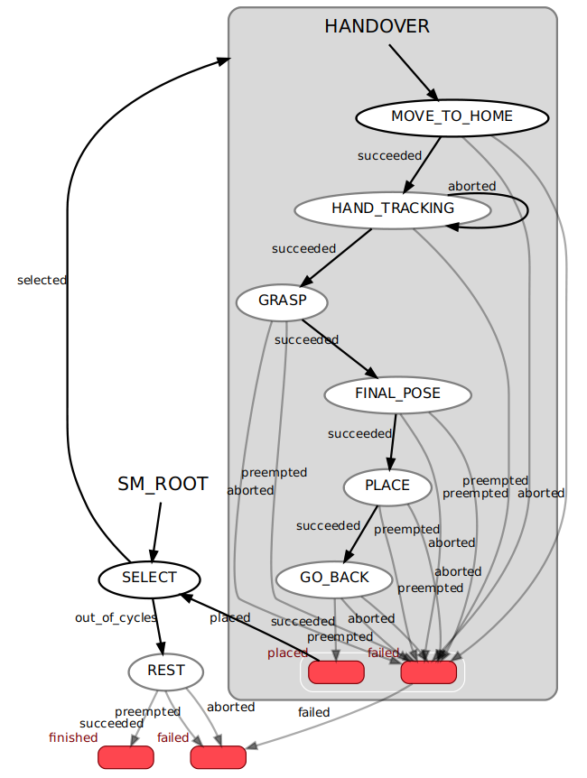

## Running the State Machine

To run the state machine, you need to launch two nodes:

1. **`controller_server.py`**: Starts the action servers for joint control, pose control, and gripper control.
2. **`planner.py`**: Starts the SMACH state machine and coordinates the handover process.

To launch these nodes, use the following commands depending on the robot model:

### For **UR5** robot:

```bash
ros2 launch smach_handover_ctrl handover_controller.launch.py robot:=ur5
```

### For **Panda** robot:

```bash
ros2 launch smach_handover_ctrl handover_controller.launch.py robot:=panda
```

Once the nodes are running, the robot will start the handover process, transitioning through various states like tracking, grasping, and placing objects based on the state machine's flow.

<p align="center">
      
</p>
